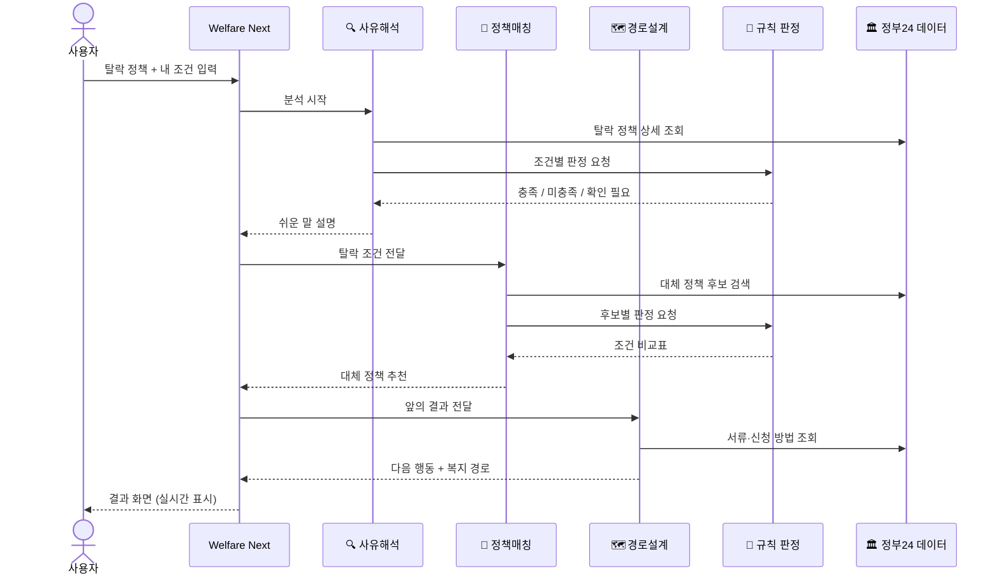
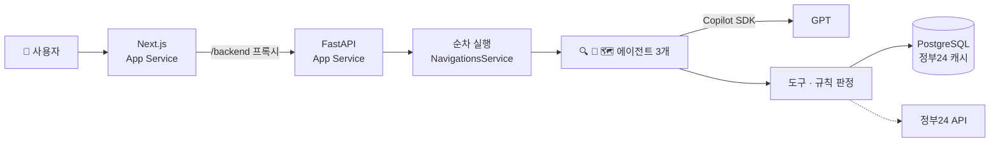

<div align="center">

# 🧭 Welfare Next

### 떨어진 그 자리에서, 다음 복지까지

복지정책에서 탈락한 사람을 방치하지 않고<br/>
**탈락 사유 → 대체 정책 → 다음 행동**까지 한 번에 이어주는 AI 복지 네비게이터


**[🌐 바로 체험하기](https://chungdo-client-dev-fabjesb7hpedbhd9.japaneast-01.azurewebsites.net)** · **[📘 PRD](./PRD.md)** · **[🛠 TRD](./TRD.md)** · **[🔌 API](./docs/API.md)** · **[💻 프론트 코드](https://github.com/Terminal-Busan/chungdo-client)** · **[🤖 백엔드 코드](https://github.com/Terminal-Busan/chungdo-server)** · **[📄 Swagger](https://<백엔드-주소>/docs)**

로그인 없이 **"시연 사례 입력"** 버튼 하나로 전체 기능을 사용할 수 있습니다.

</div>

---

## 📑 목차

1. [한눈에 보기](#-한눈에-보기)
2. [이런 분께 필요해요](#-이런-분께-필요해요)
3. [사용 설명서](#-사용-설명서)
4. [결과 화면 읽는 법](#-결과-화면-읽는-법)
5. [AI 에이전트는 이렇게 일해요](#-ai-에이전트는-이렇게-일해요)
6. [믿을 수 있는 이유](#-믿을-수-있는-이유)
7. [자주 묻는 질문](#-자주-묻는-질문)
8. [기술 정보](#-기술-정보)
9. [한계와 향후 계획](#-한계와-향후-계획)

---

## ✨ 한눈에 보기

| | 지금까지 | Welfare Next와 함께 |
|---|---|---|
| 😵 탈락 통지서 | "소득인정액 초과"가 무슨 뜻인지 직접 검색 | 어느 조건에서 떨어졌는지 **쉬운 말로 설명** |
| 🔍 다른 정책 찾기 | 정책마다 조건을 하나씩 열어보며 비교 | 내 조건으로 **가능성 있는 정책과 조건 비교표** |
| 🧾 다음 행동 | 재신청? 이의신청? 서류는? 흩어진 정보 | **체크리스트와 신청 순서**로 정리 |

> 💡 **입력 한 번 → 설명·대안·행동까지.** 탈락 이후 "이제 뭘 해야 하지?"까지 걸리던 탐색 시간을 줄입니다.

<!-- 📸 스크린샷 자리: 결과 화면 전체 캡처를 images/result.png로 넣고 아래 주석을 해제하세요 -->
<!--  -->

---

## 🙋 이런 분께 필요해요

- 🏠 **주거·생활 지원을 신청했다가 탈락**했는데 이유를 잘 모르겠는 분
- 🧑‍💼 복지 제도를 **처음 알아보는 사회 초년생·1인 가구**
- 👨‍👩‍👧 부모님이나 가족을 **대신해서 지원 제도를 찾아보는 보호자**
- 📍 우리 지역(예: 경북·청도)의 **지자체 지원**까지 함께 보고 싶은 분

---

## 📖 사용 설명서

### STEP 1 · 시작하기
첫 화면의 **[내 상황으로 찾아보기]** 를 누르면 같은 페이지 아래의 입력 폼으로 이동해요. 처음이라면 폼 아래 **[시연 사례 입력]** 을 눌러 예시 상황이 자동으로 채워진 상태로 바로 체험할 수 있어요.

### STEP 2 · 내 상황 입력하기
| 입력 항목 | 설명 |
|---|---|
| 🔎 신청했던 정책 | 정책 이름을 쓰고 **[정책 검색]** → 정부24 검색 결과에서 선택 |
| 📝 안내받은 탈락 사유 | 통지서 내용 (선택, 주민번호·전화번호는 자동으로 가려져요) |
| 👤 나이 · 거주 지역 | 예: 27세, 경상북도 청도군 |
| 🏠 가구 형태 · 가구원 수 | 1인 · 부부 · 한부모 · 다자녀 · 그 외 |
| 💰 월 소득 | 세전 월 소득, 원 단위 |
| 🏢 주거 형태 · 경제활동 상태 | 자가/전세/월세, 재직·자영업/구직 중/학생 |
| ♿ 장애 여부 · ✅ 저장 동의 | 동의해야 분석을 시작할 수 있어요 |

> 🔒 이름, 주민등록번호, 연락처는 **묻지 않습니다.**

### STEP 3 · 분석 기다리기
**[다음 지원 찾기]** 를 누르면 "조건을 확인하고 있어요"가 표시되는 동안 서버에서 세 AI 에이전트가 차례로 일해요.

```
🔍 사유해석 에이전트 → 🧩 정책매칭 에이전트 → 🗺️ 경로설계 에이전트
```

### STEP 4 · 결과 확인하기
1. **❓ 왜 탈락했나요?** — 떨어진 조건과 쉬운 설명, 어려운 용어 풀이
2. **📋 지금 검토해볼 지원** — 정책별 조건 비교, 누르면 정책 상세 창
3. **✅ 다음에 무엇을 하면 되나요?** — 재신청·추가서류·이의신청·신규신청

분석 결과는 **24시간 뒤 자동 삭제**돼요.

---

## 🔎 결과 화면 읽는 법

### 조건 표시
| 표시 | 의미 |
|:---:|---|
| 🟢 **입력 조건과 일치** | 정부24 지원조건 기준으로 해당돼요 |
| 🔴 **조건이 맞지 않음** | 정부24 지원조건 기준으로 해당되지 않아요 |
| 🟡 **추가 확인 필요** | 입력 정보만으로는 판단할 수 없어요 (재산, 소득인정액, 세부 선정기준 등) |

### 알아두세요
- 💰 **소득** — 입력한 월 소득으로 계산한 중위소득 비율은 참고용이에요. 정책에 "소득인정액" 기준이 있으면 "추가 확인 필요"로 보여드려요
- 🧾 떨어진 조건이 코드로 확인되지 않으면 "담당 기관의 선정기준 확인이 필요해요"라고 안내해요

---

## 🤖 AI 에이전트는 이렇게 일해요



| 에이전트 | 하는 일 | 사용하는 도구 |
|---|---|---|
| 🔍 **사유해석** | 어느 조건에서 떨어졌는지 쉬운 말로 설명 | 정책 상세 조회, 규칙 판정 |
| 🧩 **정책매칭** | 그 조건을 피하는 대체 정책을 찾고 조건별 비교 | 정책 검색, 규칙 판정 |
| 🗺️ **경로설계** | 재신청·추가서류·이의신청 등 다음 행동과 신청 순서 제안 | 정책 상세 조회 |

세 에이전트는 서버에서 순서대로 실행되고(앞 단계 결과를 다음 단계에 전달), **GitHub Copilot SDK**를 통해 GPT 모델과 대화합니다. AI 호출이 실패하면 규칙 기반 설명으로 결과를 이어서 제공해요.

---

## 🛡️ 믿을 수 있는 이유

| 원칙 | 어떻게 지키나요 |
|---|---|
| 🏛️ **공식 데이터만** | 행정안전부 정부24 공공서비스(혜택) 정보만 사용하고, 추천 정책은 모두 실제 서비스ID로 검증해요 |
| 📏 **판정은 규칙이, 설명은 AI가** | 자격 충족 여부는 정부24 지원조건 코드로 계산해요. AI는 판정하지 않고 설명만 해요 |
| 🚫 **지어내지 않기** | 데이터에 없는 기한·금액은 만들지 않고 "통지서 또는 신청처에서 확인"으로 안내해요 |
| 🔒 **개인정보 최소화** | 이름·주민번호·연락처 미수집, 민감 정보 자동 마스킹, 24시간 후 자동 삭제 |
| ✅ **동의 후 저장** | 저장에 동의해야 분석을 시작하고, 결과는 24시간 뒤 자동 삭제돼요 |
| 🧱 **프롬프트 인젝션 방어** | 사용자가 입력한 문구는 데이터로만 다루고, AI 도구는 사용자 데이터를 바꾸지 않아요 |

> ⚖️ Welfare Next는 안내 서비스입니다. **최종 자격 판단은 담당 기관에 있습니다.**

---

## ❓ 자주 묻는 질문

<details>
<summary><b>회원가입이 필요한가요?</b></summary>

아니요. 로그인 없이 바로 쓸 수 있어요.
</details>

<details>
<summary><b>입력한 정보는 저장되나요?</b></summary>

분석에 필요한 조건만 24시간 동안 임시로 저장되고 자동 삭제돼요. 이름·주민번호·연락처는 받지 않아요.
</details>

<details>
<summary><b>"입력 조건과 일치"면 무조건 받을 수 있나요?</b></summary>

아니요. 정부24 지원조건 코드 기준으로 해당된다는 뜻이에요. 재산이나 세부 선정기준은 별도 심사가 있으니 신청처에서 꼭 확인해 주세요.
</details>

<details>
<summary><b>"추가 확인 필요"는 왜 나오나요?</b></summary>

재산 기준이나 임신·출산 여부처럼 Welfare Next가 묻지 않는 조건이 있거나, 선정기준이 문장으로만 적혀 있어 자동 판정이 어려운 경우예요.
</details>

<details>
<summary><b>지자체 지원도 나오나요?</b></summary>

네. 정부24 데이터에는 중앙부처뿐 아니라 지자체·공공기관 서비스도 포함돼 있어서, 거주 지역에 맞는 지원도 함께 찾아요.
</details>

---

## 🧰 기술 정보

### 기술 스택
| 영역 | 기술 |
|---|---|
| 🎨 프론트엔드 | Next.js 16 · React 19 · TypeScript · Tailwind CSS 4 |
| ⚙️ 백엔드 | Python 3.14 · FastAPI |
| 🤖 AI 에이전트 | **GitHub Copilot SDK** (GPT 모델) · 에이전트 3개 순차 실행 |
| 🏛️ 데이터 | 정부24 공공서비스(혜택) 정보 API (공공데이터포털) · PostgreSQL |
| ☁️ 클라우드 | Azure App Service (프론트·백엔드) · Azure Database for PostgreSQL · Application Insights · GitHub Actions 배포 |

### 아키텍처


### API 요약
| Method | Path | 설명 |
|---|---|---|
| `GET` | `/api/health` | 상태 확인 |
| `GET` | `/api/policies` | 정책 검색 |
| `GET` | `/api/policies/{id}` | 정책 상세 |
| `POST` | `/api/navigations` | 분석 세션 생성 |
| `GET` | `/api/navigations/{id}/stream` | 에이전트 실행 (실시간) |
| `GET` | `/api/navigations/{id}` | 결과 조회 |
| `DELETE` | `/api/navigations/{id}` | 결과 삭제 (화면 연결 예정) |

자세한 요청·응답은 [docs/API.md](./docs/API.md)를 참고하세요.

### 로컬 실행
```bash
# 백엔드 (chungdo-server)
pip install -r requirements.txt
python -m copilot download-runtime          # Copilot SDK 런타임 준비
python -m uvicorn main:app --reload --port 8000 --env-file .env

# 프론트엔드 (chungdo-client)
npm install
API_SERVER_URL=http://localhost:8000 npm run dev
```

| 환경변수 | 용도 |
|---|---|
| `DATABASE_URL` | PostgreSQL 연결 (Azure는 `sslmode=verify-full`) |
| `COPILOT_GITHUB_TOKEN` | Copilot SDK 인증 (`GITHUB_TOKEN`도 허용) |
| `COPILOT_MODEL` | 선택, 비우면 사용 가능한 GPT 모델 자동 선택 |
| `GOV24_API_KEY` | 공공데이터포털 인증키 |
| `FRONT_URL` | CORS 허용 주소 |
| `APPLICATIONINSIGHTS_CONNECTION_STRING` | 선택, 집계 지표 전송 |
| `API_SERVER_URL` | 프론트 서버가 프록시할 백엔드 주소 |

> 🔐 비밀 값은 저장소에 커밋하지 않고 Azure 앱 설정과 GitHub Secrets로만 관리합니다.

---

## 🚧 한계와 향후 계획

| 지금 | 다음 |
|---|---|
| 복지 경로·결과 삭제는 백엔드만 완료 | 결과 화면에 신청 순서·삭제 버튼 연결 |
| 분석 중에는 로딩 문구만 표시 | 에이전트 단계 타임라인 실시간 표시 |
| 월 소득 기준 참고 비율 (재산 미반영) | 소득인정액 모의계산 연계 |
| 정부24 데이터 CLI 동기화 | 정기 자동 동기화, 지자체(예: 청도군) 지원 보강 |

---|---|
| 데모 분야(주거·고용·생활안정)만 동기화 | 전체 분야 + 정기 자동 동기화 |
| 월 소득 기준 추정 (재산 환산 미반영) | 소득인정액 모의계산 연계 |
| 지원조건 코드로 표현되지 않는 기준은 "확인 필요" | 선정기준 원문 구조화 고도화 |
| 공식 데이터 기반 안내 | 지자체(예: 청도군) 자체 지원사업 보강 |

---

<div align="center">

**청도 바이브코딩 해커톤 2026** 출품작<br/>
Made with 💙 using GitHub Copilot

</div>
